# TÀI LIỆU ĐẶC TẢ USE CASE CHI TIẾT
## ỨNG DỤNG HỌC TẬP & QUẢN LÝ TIẾN ĐỘ: CHẶNG (CHANG APP)

---

## 1. TỔNG QUAN HỆ THỐNG ACTORS

Hệ thống ứng dụng di động **Chặng** bao gồm các tác nhân (Actors) chính sau:

| Tác nhân (Actor) | Phân loại | Vai trò & Trách nhiệm |
| :--- | :--- | :--- |
| **Học sinh / Người học (Learner - Primary User)** | Con người (Chính) | Người sử dụng trực tiếp ứng dụng trên điện thoại: lên kế hoạch, chia nhỏ việc, bấm giờ tập trung Pomodoro, theo dõi thói quen, mục tiêu và phê duyệt kế hoạch AI. |
| **Trợ lý Lập kế hoạch AI (AI Planning Assistant)** | Hệ thống AI | Phân tích yêu cầu tự nhiên của người học, đối chiếu khoảng trống lịch biểu, đưa ra các khối lịch học đề xuất kèm giải thích căn cứ logic. |
| **Bộ lập lịch ngầm (System Daemon / Background Scheduler)** | Dịch vụ hệ thống | Chạy ngầm đếm giờ Pomodoro, kích hoạt thông báo đẩy nhắc lịch học / deadline, thực hiện rà soát cuối ngày và cập nhật chuỗi streak vào 00:00 hàng ngày. |

---

## 2. DANH MỤC CÁC GÓI USE CASE (USE CASE PACKAGES)

```mermaid
graph TD
    User((Người học))
    AI((Trợ lý AI))
    Daemon((System Daemon))

    subgraph UC_PKG_1["1. Onboarding & Hồ sơ cá nhân"]
        UC01["Xem Intro tương tác (M06)"]
        UC02["Chọn mục tiêu & Giờ học (M03, M04)"]
        UC03["Quản lý Hồ sơ & Cài đặt (M08, M09)"]
    end

    subgraph UC_PKG_2["2. Quản lý Công việc & Chia nhỏ 5 bước"]
        UC04["Tạo việc & Chia 5 bước (M12)"]
        UC05["Cập nhật tiến độ bước nhỏ (M13)"]
        UC06["Sắp xếp & Quản lý bước nhỏ (M15)"]
        UC07["Quản lý Hộp việc chưa lên lịch (M01, M02)"]
        UC08["Tìm kiếm, lọc & Lưu trữ (M11, M16, M20)"]
    end

    subgraph UC_PKG_3["3. Quản lý Dự án học tập"]
        UC09["Tạo & Quản lý dự án (M17, M18, M19)"]
    end

    subgraph UC_PKG_4["4. Lịch biểu & Xếp lịch thông minh"]
        UC10["Xem lịch tuần & lịch ngày (M21, M22)"]
        UC11["Tạo sự kiện lịch cố định (M23, M24)"]
        UC12["Xếp công việc vào khoảng trống (M25)"]
        UC13["Giải quyết xung đột trùng lịch (M26)"]
    end

    subgraph UC_PKG_5["5. Phiên tập trung Pomodoro"]
        UC14["Chuẩn bị & Bắt đầu phiên (M27)"]
        UC15["Đang tập trung & Thu gọn (M28)"]
        UC16["Tạm dừng / Tiếp tục học (M29)"]
        UC17["Tổng kết & Xác nhận tiến độ thực (M30)"]
    end

    subgraph UC_PKG_6["6. Mục tiêu định lượng & Thói quen"]
        UC18["Quản lý mục tiêu định lượng (M31, M32)"]
        UC19["Ghi nhận tiến độ số học (M33)"]
        UC20["Điều chỉnh đích mục tiêu (M34)"]
        UC21["Đạt mốc & Ăn mừng (M40)"]
        UC22["Điểm danh & Quản lý thói quen (M35, M36, M37)"]
    end

    subgraph UC_PKG_7["7. Trợ lý Lập kế hoạch AI"]
        UC23["Khởi tạo yêu cầu với AI (M41, M42)"]
        UC24["Kiểm duyệt phạm vi dữ liệu AI (M43, M44)"]
        UC25["Xem trước & Tinh chỉnh đề xuất (M45, M46, M47)"]
        UC26["Áp dụng kế hoạch & Hoàn tác (M48, M50)"]
        UC27["Xử lý trường hợp không thể xếp lịch (M49)"]
    end

    subgraph UC_PKG_8["8. Thống kê & Rà soát"]
        UC28["Rà soát dọn dẹp cuối ngày (M10)"]
        UC29["Báo cáo tiến độ & Nhìn lại tuần (M38, M39)"]
    end

    User --> UC01
    User --> UC02
    User --> UC03
    User --> UC04
    User --> UC05
    User --> UC06
    User --> UC07
    User --> UC08
    User --> UC09
    User --> UC10
    User --> UC11
    User --> UC12
    User --> UC13
    User --> UC14
    User --> UC15
    User --> UC16
    User --> UC17
    User --> UC18
    User --> UC19
    User --> UC20
    User --> UC21
    User --> UC22
    User --> UC23
    User --> UC24
    User --> UC25
    User --> UC26
    User --> UC27
    User --> UC28
    User --> UC29

    AI --> UC23
    AI --> UC24
    AI --> UC25
    AI --> UC26
    AI --> UC27

    Daemon --> UC15
    Daemon --> UC22
    Daemon --> UC28
```

---

## 3. ĐẶC TẢ CHI TIẾT CÁC USE CASE TRỌNG YẾU

---

### USE CASE UC-CORE-01: TẠO CÔNG VIỆC VÀ CHIA NHỎ TỐI ĐA 5 BƯỚC (M12, M15)
- **Actor chính:** Người học (Learner).
- **Mục tiêu:** Tạo mới một công việc và bắt buộc/khuyến khích phân tách thành các bước nhỏ vi mô (tối đa 5 bước) để sẵn sàng thực thi.
- **Tiền điều kiện (Preconditions):** Người dùng đã hoàn thành onboarding và đang ở màn hình Home (`M05`), Danh sách công việc (`M11`), hoặc Dự án (`M19`).
- **Hậu điều kiện (Postconditions):** Bản ghi `Task` được lưu trữ kèm 1 đến 5 bản ghi `Subtask`. Tiến độ ban đầu được tính là `0%`.

#### Luồng sự kiện chính (Main Flow):
1. Người dùng bấm nút "+" (Tạo công việc) từ màn hình `M05`, `M11` hoặc `M19`.
2. Hệ thống hiển thị form Tạo công việc `M12`.
3. Người dùng nhập Tên công việc (ví dụ: *"Đề cương môn Luật Kinh tế"*).
4. Người dùng chọn Dự án liên kết (nếu tạo từ M19 thì tự động điền sẵn).
5. Người dùng chọn Hạn nộp (Ngày, Giờ) và Độ ưu tiên (Cao, Trung bình, Thấp).
6. Khu vực "Chia nhỏ bước thực hiện": Hệ thống hiển thị sẵn 3 ô bước nhỏ.
7. Người dùng nhập nội dung cho từng bước:
   - Bước 1: *"Đọc chương 1 & 2"*
   - Bước 2: *"Lập dàn ý 4 luận điểm"*
   - Bước 3: *"Viết phần mở đầu"*
8. Người dùng có thể bấm "+ Thêm bước" để bổ sung Bước 4, Bước 5.
9. Người dùng nhấn nút "Lưu công việc".
10. Hệ thống kiểm tra hợp lệ, lưu vào CSDL cục bộ và điều hướng sang `M13 (Chi tiết công việc)`.

#### Luồng thay thế / Rẽ nhánh (Alternative Flows):
- **A1 - Người dùng cố thêm bước thứ 6:**
  - Nút "+ Thêm bước" tự động bị ẩn hoặc vô hiệu hóa (`disabled`) khi đã đủ 5 bước.
  - Hệ thống hiển thị tooltip giải thích: *"Mỗi công việc chỉ nên chia tối đa 5 bước để chống quá tải. Hãy tạo thêm công việc mới hoặc dự án riêng nếu nội dung quá lớn."*
- **A2 - Người dùng muốn sắp xếp lại thứ tự các bước:**
  - Tại màn hình Chi tiết `M13`, người dùng chọn "Quản lý 5 bước" (`M15`).
  - Hệ thống mở giao diện với menu 3 chấm cạnh mỗi bước: "Chuyển lên trên", "Chuyển xuống dưới", "Đổi tên", "Xóa".
  - Người dùng bấm chuyển thứ tự -> Hệ thống cập nhật số thứ tự tạm thời -> Người dùng bấm "Lưu các bước".
- **A3 - Hạn nộp ở quá khứ:**
  - Hệ thống báo lỗi validation đỏ tại trường Hạn nộp: *"Hạn nộp không thể trước thời điểm hiện tại"*. Nút Lưu bị khóa.

---

### USE CASE UC-CORE-02: THỰC HIỆN PHIÊN TẬP TRUNG POMODORO & TỔNG KẾT TIẾN ĐỘ THỰC TẾ (M27 - M30)
- **Actor chính:** Người học (Learner).
- **Actor hỗ trợ:** Bộ lập lịch ngầm (Background Service).
- **Mục tiêu:** Tập trung giải quyết một bước nhỏ cụ thể trong một khoảng thời gian xác định, ghi nhận chính xác thời gian thực tế và tiến độ bước nhỏ độc lập với công việc lớn.
- **Tiền điều kiện:** Công việc có ít nhất 1 bước nhỏ chưa hoàn thành.

#### Luồng sự kiện chính (Main Flow):
1. Tại `M13`, người dùng bấm nút "Tập trung vào bước 3" (hoặc chọn bước từ `M27`).
2. Màn hình Chuẩn bị `M27` xuất hiện, hiển thị thông tin bước 3, thời lượng mặc định 25 phút và tùy chọn âm thanh nền (White Noise).
3. Người dùng bấm "Bắt đầu tập trung".
4. Màn hình `M28` hiển thị đồng hồ đếm ngược kích thước lớn. Linh vật Chặng chuyển sang tư thế tập trung tĩnh. Background timer bắt đầu đếm.
5. Khi hết thời lượng hoặc người dùng bấm "Kết thúc phiên", chuông êm dịu vang lên.
6. Hệ thống chuyển sang màn hình Tổng kết phiên `M30`:
   - Hiển thị thời gian tập trung thực tế: **25 phút 00 giây**.
   - Hộp xác nhận: *"Bạn đã hoàn thành Bước 3 chưa?"*.
7. Người dùng bấm chọn "Đã hoàn thành".
8. Hệ thống đánh dấu bước 3 là `COMPLETED`, cập nhật tiến độ công việc từ `2/5` lên `3/5`.
9. Người dùng bấm "Về hôm nay", dữ liệu đồng bộ vào tổng thời gian học trong ngày.

#### Luồng thay thế / Rẽ nhánh (Alternative Flows):
- **A1 - Tạm dừng giữa chừng (Pause & Resume):**
  - Người dùng bấm "Tạm dừng" tại phút thứ 14:15.
  - Hệ thống chuyển sang màn hình `M29`. Đồng hồ dừng chính xác ở 14:15. Linh vật chuyển sang tư thế nghỉ ngơi thư giãn.
  - Người dùng giải quyết việc riêng xong và bấm "Tiếp tục học".
  - Hệ thống quay lại `M28`, đồng hồ tiếp tục chạy tiếp từ giây thứ 14:15.
- **A2 - Kết thúc sớm giữa chừng (Stop early):**
  - Người dùng đang học đến phút thứ 18:30 thì có việc bận đột xuất, bấm "Kết thúc phiên".
  - Màn hình `M30` ghi nhận chính xác thời lượng thực tế là **18 phút 30 giây** (tuyệt đối không mặc định ghi 25 phút).
  - Người dùng chọn "Chưa xong bước 3, cần làm thêm" -> Bước 3 vẫn giữ trạng thái chưa xong, tiến độ công việc vẫn giữ nguyên `2/5`, nhưng 18 phút 30 giây vẫn được cộng dồn vào thống kê nỗ lực trong ngày.
- **A3 - Thu gọn phiên học (Minimize / Picture-in-Picture):**
  - Người dùng bấm "Thu gọn phiên" trên `M28`.
  - Màn hình quay về trang trước đó, phiên học thu nhỏ thành Floating Bar / Mini Widget ghim ở đáy màn hình. Đồng hồ tiếp tục chạy ổn định nhờ Android/iOS Foreground Service.

---

### USE CASE UC-CORE-03: XẾP VIỆC VÀO LỊCH & GIẢI QUYẾT XUNG ĐỘT TRÙNG LỊCH (M25, M26)
- **Actor chính:** Người học (Learner).
- **Mục tiêu:** Gán một công việc hoặc bước nhỏ vào một khung giờ trống trong ngày; tự động phát hiện và giải quyết xung đột thời gian.

#### Luồng sự kiện chính (Main Flow):
1. Người dùng mở Lịch ngày `M22`, thấy khoảng trống từ 20:00 đến 21:00.
2. Người dùng chạm vào nút "Xếp việc vào đây" trên khoảng trống.
3. Màn hình `M25` mở ra với giờ bắt đầu được điền sẵn là 20:00.
4. Người dùng chọn Công việc: *"Học Tiếng Anh"*, chọn bước: *"Luyện nghe Part 1"*, thời lượng: 30 phút (kết thúc 20:30).
5. Khung xem trước hiển thị sự kiện nằm trọn trong khoảng trống hợp lệ (không đè lên lịch nào).
6. Người dùng nhấn "Thêm vào lịch".
7. Hệ thống tạo bản ghi `ScheduleEvent` và hiển thị khối lịch mới trên timeline `M22`.

#### Luồng thay thế (Xung đột lịch - Conflict Flow):
- **A1 - Phát hiện trùng lặp với lịch cố định:**
  - Giả sử lúc 20:00 - 21:00 người dùng đã có lịch "Lớp học trực tuyến Toán". Người dùng lại chọn xếp việc từ 20:15 - 20:45.
  - Hệ thống kích hoạt Conflict Resolution Engine và tự động chuyển tiếp tới `M26 (Xử lý trùng lịch)`.
  - Màn hình `M26` hiển thị cảnh báo: *"Trùng lặp với: Lớp học trực tuyến Toán (20:00 - 21:00)"*.
  - Người dùng có 3 phương án:
    1. **Chấp nhận khung giờ trống gợi ý:** Hệ thống đề xuất ngay `21:05 - 21:35` (ngay sau khi lớp Toán tan). Người dùng bấm chọn -> Quay về `M25` với giờ mới 21:05 -> Nhấn "Thêm vào lịch" để lưu.
    2. **Tự chọn giờ khác:** Người dùng bấm vào -> Mở time picker chọn khung giờ khác.
    3. **Vẫn thêm vào giờ trùng:** Người dùng chấp nhận học song song -> Hệ thống lưu sự kiện mới đè lên, giữ nguyên sự kiện cũ.

---

### USE CASE UC-CORE-04: THEO DÕI MỤC TIÊU ĐỊNH LƯỢNG - "GHI NHẬN THÊM" VS "ĐIỀU CHỈNH ĐÍCH" (M31 - M34, M40)
- **Actor chính:** Người học (Learner).
- **Mục tiêu:** Phân tách rõ ràng giữa việc học thêm được số lượng mới và việc điều chỉnh chỉ tiêu kế hoạch.

#### Nhánh 1: Ghi nhận thêm tiến độ (Add Progress Log - M33)
1. Người dùng mở màn hình Chi tiết mục tiêu `M33` của mục tiêu *"Học 100 từ vựng chuyên ngành"*. Tiến độ hiện tại: `40/100 từ` (40%).
2. Người dùng nhấn nút "Ghi nhận thêm".
3. Popup nhập liệu xuất hiện: Người dùng nhập `10` từ vừa học xong.
4. Hệ thống hiển thị xem trước: `50/100 từ (50%)`.
5. Người dùng nhấn "Lưu".
6. Hệ thống thêm một dòng lịch sử vào bảng `GoalProgressLog` (+10 từ vào ngày hiện tại), cập nhật `Goal.current_value = 50`.
7. *Trường hợp chạm đích:* Nếu người dùng nhập `+50` (đưa tổng lên 100/100) -> Hệ thống tự động kích hoạt màn hình Chúc mừng đạt mốc `M40`.

#### Nhánh 2: Điều chỉnh đích mục tiêu (Adjust Target Value - M34)
1. Người dùng mở `M33`, nhận thấy kỳ thi sắp tới nên giảm bớt khối lượng từ 100 từ xuống còn 80 từ.
2. Người dùng bấm nút "Điều chỉnh mục tiêu".
3. Màn hình `M34` xuất hiện, ô Đích mục tiêu hiển thị giá trị hiện tại là `100`.
4. Người dùng sửa thành `80`.
5. Khu vực xem trước hiển thị:
   - *Số lượng đã hoàn thành:* Giữ nguyên **40 từ**.
   - *Tỷ lệ hoàn thành mới:* Tăng từ **40% lên 50% (40/80)**.
   - *Thông báo minh bạch:* "Toàn bộ lịch sử ghi nhận cũ được giữ nguyên, không có từ mới nào được ghi nhận thêm."
6. Người dùng nhấn "Lưu đích mới".
7. Hệ thống cập nhật trường `Goal.target_value = 80`. Không tạo thêm bất kỳ bản ghi `GoalProgressLog` nào.

---

### USE CASE UC-CORE-05: TRỢ LÝ AI LẬP KẾ HOẠCH HỌC TẬP THÔNG MINH (M41 - M50)
- **Actor chính:** Người học (Learner).
- **Actor hỗ trợ:** Trợ lý AI (AI Planning Assistant).
- **Mục tiêu:** Tự động xếp lịch thông minh dựa trên ngôn ngữ tự nhiên, minh bạch dữ liệu và cung cấp quyền kiểm soát / hoàn tác tuyệt đối cho người học.

#### Luồng sự kiện chính (Main Flow):
1. Người dùng bấm biểu tượng Trợ lý AI tại `M05`, mở màn hình Khởi đầu `M41`.
2. Người dùng chọn template: *"Sắp xếp ôn thi 3 môn trong tuần này"* và bấm Gửi.
3. Màn hình Hội thoại `M42`: AI phân tích và hỏi lại 2 câu hỏi làm rõ:
   - *"Bạn muốn dành bao nhiêu tiếng tự học mỗi ngày?"* -> Người dùng chọn chip: *"2 tiếng"*.
   - *"Môn nào bạn cần ưu tiên hoàn thành trước thứ 5?"* -> Người dùng chọn: *"Môn Toán"*.
4. Màn hình Kiểm tra yêu cầu & Phạm vi dữ liệu `M43`:
   - Hiển thị danh sách tham số đã chốt.
   - Hiển thị mục Bảo mật & Phạm vi dữ liệu: *"AI chỉ đọc lịch trống tuần này và 3 công việc ôn thi, không truy cập thông tin cá nhân khác"*.
5. Người dùng bấm "Tạo kế hoạch học".
6. Màn hình `M44` hiển thị tiến trình đang tính toán kèm nút "Hủy".
7. Thuật toán AI chạy xong, chuyển sang màn hình Xem trước kế hoạch đề xuất `M45`.
   - Hiển thị các khối lịch mới được xếp vào các khoảng trống trong tuần.
8. Người dùng bấm "Xem giải thích đề xuất" (`M46`): AI giải thích: *"Môn Toán được xếp vào sáng thứ 3 và thứ 4 vì đây là khung giờ bạn có độ tập trung cao nhất theo khảo sát"*.
9. Người dùng bấm "Áp dụng kế hoạch này".
10. Hệ thống ghi toàn bộ batch sự kiện vào bảng `ScheduleEvent`, chuyển sang `M48 (Kết quả áp dụng)`.
11. Màn hình `M48` hiển thị nút nổi bật: **"Hoàn tác áp dụng" (Undo)**. Người dùng kiểm tra thấy ưng ý, bấm "Về màn hình Lịch".

#### Luồng thay thế:
- **A1 - Người dùng muốn chỉnh sửa một phần trước khi áp dụng:**
  - Tại `M45`, người dùng bấm "Chỉnh sửa đề xuất" (`M47`).
  - Người dùng đổi thời lượng môn Toán từ 45 phút thành 30 phút, xóa bớt một buổi tối thứ 6.
  - Người dùng bấm "Lưu bản nháp" -> Quay lại M45 -> Bấm "Áp dụng".
- **A2 - Người dùng bấm Hoàn tác ngay tại M48:**
  - Người dùng đổi ý, bấm "Hoàn tác áp dụng".
  - Hệ thống gọi hàm Rollback: Xóa sạch toàn bộ các sự kiện vừa tạo từ đợt đề xuất này. Lịch của người dùng trở về nguyên trạng ban đầu.
- **A3 - AI không tìm được phương án xếp lịch (M49):**
  - Do lịch tuần đã kín mít, hệ thống chuyển sang `M49 (Chưa tạo được kế hoạch)`.
  - Hệ thống giữ nguyên nội dung prompt ban đầu và đưa ra gợi ý: "Giảm thời lượng phiên học từ 45p xuống 25p" hoặc "Tự xếp lịch thủ công".

---

### USE CASE UC-CORE-06: RÀ SOÁT DỌN DẸP CUỐI NGÀY (M10)
- **Actor chính:** Người học (Learner).
- **Mục tiêu:** Xử lý các công việc tồn đọng chưa xong trong ngày hôm nay, làm sạch danh sách việc và bảo toàn hạn nộp gốc.

#### Luồng sự kiện chính (Main Flow):
1. Vào 21:30 hàng ngày (hoặc người dùng chủ động mở), hệ thống gửi thông báo nhắc rà soát ngày.
2. Người dùng mở `M10 (Rà soát cuối ngày)`.
3. Hệ thống liệt kê 2 công việc chưa làm xong hôm nay:
   - Công việc A: *"Làm bài tập Hóa"* (Hạn nộp: 23:59 ngày mai).
   - Công việc B: *"Đọc sách"* (Không có hạn nộp).
4. Đối với Công việc A: Người dùng bấm chọn **[Chuyển sang ngày mai]** -> Hệ thống cập nhật `scheduled_date = Tomorrow`. Hạn nộp gốc (ngày mai) được giữ nguyên tuyệt đối.
5. Đối với Công việc B: Người dùng bấm chọn **[Đưa về Hộp việc]** -> Hệ thống xóa `scheduled_date` (set thành `null`), công việc quay trở lại `M01 (Hộp việc chưa lên kế hoạch)`.
6. Người dùng bấm "Hoàn tất rà soát".
7. Linh vật Chặng chúc ngủ ngon với nền ấm áp. Widget việc hôm nay trên Home `M05` được làm sạch hoàn toàn, sẵn sàng cho ngày mới.

---
*Tài liệu đặc tả Use Case chuẩn UML 2.5 cho Hệ sinh thái Di động Chặng.*
