# TÀI LIỆU THIẾT KẾ CƠ SỞ DỮ LIỆU & SƠ ĐỒ ERD
## ỨNG DỤNG HỌC TẬP & QUẢN LÝ TIẾN ĐỘ: CHẶNG (CHANG APP)

---

## 1. MÔ HÌNH THỰC THỂ LIÊN KẾT (MERMAID ERD)

```mermaid
erDiagram
    USERS ||--o| USER_PREFERENCES : "has"
    USERS ||--o{ PROJECTS : "owns"
    USERS ||--o{ TASKS : "creates"
    USERS ||--o{ FOCUS_SESSIONS : "performs"
    USERS ||--o{ SCHEDULE_EVENTS : "schedules"
    USERS ||--o{ GOALS : "sets"
    USERS ||--o{ HABITS : "tracks"
    USERS ||--o{ NOTIFICATIONS : "receives"
    USERS ||--o{ AI_PLAN_PROPOSALS : "requests"
    USERS ||--o{ DAY_REVIEW_LOGS : "records"

    PROJECTS ||--o{ TASKS : "contains"
    TASKS ||--|{ SUBTASKS : "divided_into (1..5)"
    TASKS ||--o{ FOCUS_SESSIONS : "associated_with"
    TASKS ||--o{ SCHEDULE_EVENTS : "booked_in"

    SUBTASKS ||--o{ FOCUS_SESSIONS : "focused_on"
    SUBTASKS ||--o{ SCHEDULE_EVENTS : "targets"

    GOALS ||--o{ GOAL_PROGRESS_LOGS : "logs_incremental"
    GOALS ||--o{ HABITS : "linked_to"

    HABITS ||--o{ HABIT_LOGS : "records_daily"

    AI_PLAN_PROPOSALS ||--|{ AI_PROPOSAL_ITEMS : "proposes"
    AI_PLAN_PROPOSALS ||--o{ SCHEDULE_EVENTS : "generates_batch"
    AI_PROPOSAL_ITEMS }o--|| TASKS : "references"
    AI_PROPOSAL_ITEMS }o--o| SUBTASKS : "references"

    USERS {
        string id PK "UUID"
        string email UK
        string full_name
        string avatar_url
        string created_at
        string updated_at
    }

    USER_PREFERENCES {
        string id PK "UUID"
        string user_id FK "REFERENCES USERS(id)"
        int daily_target_minutes "Default 60"
        boolean preferred_morning "06:00 - 09:00"
        boolean preferred_afternoon "14:00 - 17:00"
        boolean preferred_evening "19:30 - 22:30"
        string quiet_hours_start "22:30"
        string quiet_hours_end "06:30"
        boolean mascot_enabled "Default true"
        boolean reduced_motion "Default false"
        boolean has_completed_onboarding
        string created_at
        string updated_at
    }

    PROJECTS {
        string id PK "UUID"
        string user_id FK "REFERENCES USERS(id)"
        string name
        string description
        string color_hex "Brand token color"
        string deadline "ISO 8601"
        string status "ACTIVE, COMPLETED, ARCHIVED"
        string created_at
        string updated_at
    }

    TASKS {
        string id PK "UUID"
        string user_id FK "REFERENCES USERS(id)"
        string project_id FK "NULLABLE, REFERENCES PROJECTS(id)"
        string title
        string description
        string priority "LOW, MEDIUM, HIGH"
        string due_date "ISO 8601, NULLABLE"
        string scheduled_date "YYYY-MM-DD, NULLABLE"
        string status "TODO, IN_PROGRESS, COMPLETED"
        boolean is_archived "Default false"
        int progress_percentage "0 to 100"
        string created_at
        string updated_at
    }

    SUBTASKS {
        string id PK "UUID"
        string task_id FK "REFERENCES TASKS(id) ON DELETE CASCADE"
        string title
        int order_index "1 to 5"
        int estimated_minutes "Default 25"
        boolean is_completed "Default false"
        string completed_at "NULLABLE"
    }

    FOCUS_SESSIONS {
        string id PK "UUID"
        string user_id FK "REFERENCES USERS(id)"
        string task_id FK "NULLABLE, REFERENCES TASKS(id)"
        string subtask_id FK "NULLABLE, REFERENCES SUBTASKS(id)"
        int target_duration_seconds "Plan duration"
        int actual_duration_seconds "Real recorded seconds"
        string status "COMPLETED, CANCELLED, EARLY_STOPPED"
        string ambient_sound "RAIN, CAFE, OCEAN, SILENT"
        string started_at "ISO 8601"
        string ended_at "ISO 8601"
        string created_at
    }

    SCHEDULE_EVENTS {
        string id PK "UUID"
        string user_id FK "REFERENCES USERS(id)"
        string task_id FK "NULLABLE, REFERENCES TASKS(id)"
        string subtask_id FK "NULLABLE, REFERENCES SUBTASKS(id)"
        string ai_proposal_id FK "NULLABLE, REFERENCES AI_PLAN_PROPOSALS(id)"
        string title
        string event_type "CLASS, STUDY, EXAM, PERSONAL"
        string start_time "ISO 8601"
        string end_time "ISO 8601"
        string recurrence_rule "DAILY, WEEKLY, NONE"
        int reminder_minutes "Default 15"
        string created_at
        string updated_at
    }

    GOALS {
        string id PK "UUID"
        string user_id FK "REFERENCES USERS(id)"
        string title
        double target_value "Target quantity"
        double current_value "Progress quantity"
        string unit "words, pages, hours, tests"
        string deadline "ISO 8601, NULLABLE"
        string status "ACTIVE, COMPLETED, PAUSED"
        string created_at
        string updated_at
    }

    GOAL_PROGRESS_LOGS {
        string id PK "UUID"
        string goal_id FK "REFERENCES GOALS(id) ON DELETE CASCADE"
        double delta_value "Increment e.g. +10"
        double value_after "Snapshot after increment"
        string note "Optional log note"
        string logged_at "ISO 8601"
    }

    HABITS {
        string id PK "UUID"
        string user_id FK "REFERENCES USERS(id)"
        string linked_goal_id FK "NULLABLE, REFERENCES GOALS(id)"
        string title
        string repeat_days "JSON Array [1,2,3,4,5]"
        int duration_minutes "Default 15"
        string reminder_time "HH:mm"
        int current_streak "Count"
        int longest_streak "Count"
        string status "ACTIVE, ARCHIVED"
        string created_at
        string updated_at
    }

    HABIT_LOGS {
        string id PK "UUID"
        string habit_id FK "REFERENCES HABITS(id) ON DELETE CASCADE"
        string user_id FK "REFERENCES USERS(id)"
        string log_date "YYYY-MM-DD"
        string status "COMPLETED, SKIPPED"
        string logged_at "ISO 8601"
    }

    AI_PLAN_PROPOSALS {
        string id PK "UUID"
        string user_id FK "REFERENCES USERS(id)"
        string original_prompt "User raw prompt"
        string status "DRAFT, APPLIED, REVERTED, DISCARDED"
        string applied_at "ISO 8601, NULLABLE"
        string reverted_at "ISO 8601, NULLABLE"
        string created_at
    }

    AI_PROPOSAL_ITEMS {
        string id PK "UUID"
        string proposal_id FK "REFERENCES AI_PLAN_PROPOSALS(id) ON DELETE CASCADE"
        string task_id FK "REFERENCES TASKS(id)"
        string subtask_id FK "NULLABLE, REFERENCES SUBTASKS(id)"
        string start_time "ISO 8601"
        string end_time "ISO 8601"
        string reasoning "Explanation why this slot is chosen"
        boolean is_accepted "Default true"
    }

    NOTIFICATIONS {
        string id PK "UUID"
        string user_id FK "REFERENCES USERS(id)"
        string title
        string body
        string type "REMINDER_TASK, SCHEDULE_CONFLICT, MILESTONE, AI_PLAN"
        string reference_id "Task/Event/Goal ID"
        boolean is_read "Default false"
        string scheduled_at "ISO 8601"
        string created_at
    }

    DAY_REVIEW_LOGS {
        string id PK "UUID"
        string user_id FK "REFERENCES USERS(id)"
        string review_date "YYYY-MM-DD"
        int completed_tasks_count
        int rolled_over_count
        int return_to_inbox_count
        string created_at
    }
```



---

## 2. TỪ ĐIỂN DỮ LIỆU CHI TIẾT (DATA DICTIONARY)

### 2.1. Bảng `USERS` & `USER_PREFERENCES`
Lưu trữ thông tin người học và các tùy chọn cá nhân hóa giao diện, giờ học vàng, chế độ linh vật.
- **Ràng buộc:**
  - `USERS.email` là duy nhất (`UNIQUE`).
  - `USER_PREFERENCES.user_id` là khóa ngoại 1-1 với `USERS.id`.
  - `quiet_hours_start` và `quiet_hours_end` định dạng theo chuỗi giờ chuẩn `HH:mm`.

### 2.2. Bảng `PROJECTS` (Dự án học tập)
Quản lý các môn học hoặc đồ án chứa nhiều công việc con.
- `color_hex`: Lưu mã hex của 6 màu sắc trong Design Tokens (`#345D83`, `#F4D578`, `#DF967E`, `#28654C`, v.v.).
- Khi xóa `PROJECT`, các `TASKS` trực thuộc không bị xóa mà chỉ đặt `project_id = NULL` để bảo toàn dữ liệu việc học của người dùng.

### 2.3. Bảng `TASKS` & `SUBTASKS` (Công việc & 5 Bước nhỏ)
- **Ràng buộc nghiệp vụ quan trọng:**
  - `SUBTASKS.order_index`: Ràng buộc giá trị từ `1` đến `5` (`CHECK (order_index >= 1 AND order_index <= 5)`). Mỗi `task_id` không thể có quá 5 bản ghi `SUBTASKS`.
  - Khi xóa `TASK`: Tự động xóa theo tầng (`CASCADE DELETE`) toàn bộ các `SUBTASKS` tương ứng.
  - `scheduled_date`: Nếu `NULL` -> Công việc nằm trong `M01 (Hộp việc chưa lên kế hoạch)`. Nếu có giá trị ngày hôm nay -> Hiển thị trên widget `M05 (Home)` và `M02`.
  - `progress_percentage`: Giá trị tính tự động dựa trên: `(Số subtask hoàn thành / Tổng số subtask) * 100`.

### 2.4. Bảng `FOCUS_SESSIONS` (Phiên tập trung Pomodoro)
- `actual_duration_seconds`: **Cột sống còn của nghiệp vụ**. Ghi nhận số giây thực tế người dùng đã giữ màn hình tập trung. Nếu người dùng kết thúc sớm ở phút 14:20 thì giá trị lưu là `860` giây. Không bao giờ được ép thành 1500 giây (25 phút).
- `ambient_sound`: Enum lưu loại tiếng ồn trắng đã phát trong phiên.

### 2.5. Bảng `SCHEDULE_EVENTS` (Sự kiện lịch biểu)
- `start_time`, `end_time`: Lưu mốc thời gian ISO 8601 đầy đủ (ví dụ `2026-11-19T20:00:00+07:00`).
- `ai_proposal_id`: Lưu ID đề xuất nếu sự kiện này do Trợ lý AI tạo ra (dùng để phục vụ chức năng **Hoàn tác toàn bộ đợt xếp lịch - Rollback batch**).

### 2.6. Bảng `GOALS` & `GOAL_PROGRESS_LOGS` (Mục tiêu định lượng)
- **Tách bạch 2 trường:**
  - `target_value`: Con số đích (ví dụ 100). Khi người dùng chạy chức năng "Điều chỉnh mục tiêu" `M34`, chỉ cập nhật trường này.
  - `current_value`: Con số tích lũy thực tế (ví dụ 40). Khi chạy chức năng "Ghi nhận thêm" `M33`, trường này cộng thêm `delta_value` và tạo 1 dòng mới trong `GOAL_PROGRESS_LOGS`.
- `GOAL_PROGRESS_LOGS.delta_value`: Giá trị tăng thêm mỗi lần học (ví dụ +10).

### 2.7. Bảng `HABITS` & `HABIT_LOGS` (Thói quen & Chuỗi ngày)
- `repeat_days`: Lưu chuỗi JSON mảng số nguyên các ngày kích hoạt trong tuần (Ví dụ `[1, 3, 5]` = Thứ 2, Thứ 4, Thứ 6; Quy ước 1 = Monday ... 7 = Sunday).
- `HABIT_LOGS.log_date`: Khóa duy nhất tổ hợp `(habit_id, log_date)` ngăn chặn việc check-in trùng lặp 2 lần trong 1 ngày.
- Bỏ check-in (Undo) = `DELETE FROM HABIT_LOGS WHERE habit_id = ? AND log_date = ?`.

### 2.8. Bảng `AI_PLAN_PROPOSALS` & `AI_PROPOSAL_ITEMS`
- Lưu trữ toàn bộ các đề xuất phân bổ lịch do Trợ lý AI sinh ra.
- Trạng thái `status`:
  - `DRAFT`: Đang ở màn hình xem trước `M45`.
  - `APPLIED`: Người dùng đã nhấn "Áp dụng kế hoạch", các sự kiện đã được clone sang bảng `SCHEDULE_EVENTS`.
  - `REVERTED`: Người dùng đã bấm nút "Hoàn tác áp dụng" tại `M48` hoặc `M50`. Hệ thống xóa các bản ghi `SCHEDULE_EVENTS` có `ai_proposal_id = proposal.id`.

---

## 3. CHIẾN LƯỢC ĐÁNH INDEX TỐI ƯU TRÊN POSTGRESQL (SUPABASE)

Để ứng dụng Flutter kết nối Supabase chạy mượt mà 60–120 FPS và tối ưu hóa chi phí đọc DB:

```sql
-- 1. Index truy vấn việc theo ngày hôm nay & trạng thái
CREATE INDEX idx_tasks_scheduled_date ON tasks(user_id, scheduled_date, status);

-- 2. Index truy vấn hạn nộp & quá hạn
CREATE INDEX idx_tasks_due_date ON tasks(user_id, due_date, status);

-- 3. Index sắp xếp các bước nhỏ
CREATE INDEX idx_subtasks_task_order ON subtasks(task_id, order_index);

-- 4. Index kiểm tra trùng lịch (Overlap Check Index)
CREATE INDEX idx_schedule_events_time ON schedule_events(user_id, start_time, end_time);

-- 5. Index truy vấn thói quen theo ngày
CREATE INDEX idx_habit_logs_date ON habit_logs(habit_id, log_date);

-- 6. Index truy vấn tổng số giờ học theo thời gian
CREATE INDEX idx_focus_sessions_time ON focus_sessions(user_id, started_at);

-- 7. Index hoàn tác batch đề xuất AI
CREATE INDEX idx_schedule_ai_proposal ON schedule_events(ai_proposal_id);
```

---

## 4. BẢO MẬT BẰNG ROW LEVEL SECURITY (RLS) TRÊN SUPABASE

Mỗi người dùng trong Flutter App sau khi đăng nhập qua `supabase_flutter` sẽ có một `auth.uid()`. Hệ thống kích hoạt RLS trên tất cả các bảng để đảm bảo không người dùng nào xem hoặc can thiệp được dữ liệu của người khác:

```sql
-- Kích hoạt RLS cho toàn bộ các bảng nghiệp vụ
ALTER TABLE user_preferences ENABLE ROW LEVEL SECURITY;
ALTER TABLE projects ENABLE ROW LEVEL SECURITY;
ALTER TABLE tasks ENABLE ROW LEVEL SECURITY;
ALTER TABLE subtasks ENABLE ROW LEVEL SECURITY;
ALTER TABLE focus_sessions ENABLE ROW LEVEL SECURITY;
ALTER TABLE schedule_events ENABLE ROW LEVEL SECURITY;
ALTER TABLE goals ENABLE ROW LEVEL SECURITY;
ALTER TABLE goal_progress_logs ENABLE ROW LEVEL SECURITY;
ALTER TABLE habits ENABLE ROW LEVEL SECURITY;
ALTER TABLE habit_logs ENABLE ROW LEVEL SECURITY;
ALTER TABLE ai_plan_proposals ENABLE ROW LEVEL SECURITY;
ALTER TABLE ai_proposal_items ENABLE ROW LEVEL SECURITY;
ALTER TABLE notifications ENABLE ROW LEVEL SECURITY;
ALTER TABLE day_review_logs ENABLE ROW LEVEL SECURITY;

-- Mẫu chính sách RLS chuẩn: Người dùng sở hữu toàn quyền với bản ghi của chính mình
CREATE POLICY "Users own their preferences" 
ON user_preferences FOR ALL USING (auth.uid() = user_id);

CREATE POLICY "Users own their projects" 
ON projects FOR ALL USING (auth.uid() = user_id);

CREATE POLICY "Users own their tasks" 
ON tasks FOR ALL USING (auth.uid() = user_id);

CREATE POLICY "Users own their subtasks" 
ON subtasks FOR ALL USING (
    EXISTS (SELECT 1 FROM tasks WHERE tasks.id = subtasks.task_id AND tasks.user_id = auth.uid())
);

CREATE POLICY "Users own their focus sessions" 
ON focus_sessions FOR ALL USING (auth.uid() = user_id);

CREATE POLICY "Users own their schedule events" 
ON schedule_events FOR ALL USING (auth.uid() = user_id);

CREATE POLICY "Users own their goals" 
ON goals FOR ALL USING (auth.uid() = user_id);

CREATE POLICY "Users own their habits" 
ON habits FOR ALL USING (auth.uid() = user_id);
```

---

## 5. TÍCH HỢP SUPABASE REALTIME & EDGE FUNCTIONS VỚI FLUTTER

### 5.1. Supabase Realtime trong Flutter
Flutter app lắng nghe trực tiếp sự thay đổi trạng thái qua Stream của `supabase_flutter`:
```dart
// Ví dụ lắng nghe thay đổi công việc theo thời gian thực trong Flutter BLoC/Riverpod
final taskStream = supabase
    .from('tasks')
    .stream(primaryKey: ['id'])
    .eq('user_id', supabase.auth.currentUser!.id)
    .order('created_at');
```

### 5.2. Supabase Edge Functions (Deno / TypeScript)
1. **`generate-ai-plan`**: Tiếp nhận prompt từ Flutter App `M41`, đối chiếu lịch trống trên PostgreSQL, gọi Gemini API và sinh bản ghi vào `ai_plan_proposals`.
2. **`eod-rollover-reminder`**: Được gọi thông qua `pg_cron` vào 21:30 mỗi tối, gửi push notification nhắc nhở người dùng thực hiện rà soát cuối ngày `M10`.

---
*Mô hình CSDL được chuẩn hóa 3NF trên PostgreSQL/Supabase, bảo mật tuyệt đối với RLS và sẵn sàng kết nối mượt mà với ứng dụng Flutter qua supabase_flutter SDK.*
