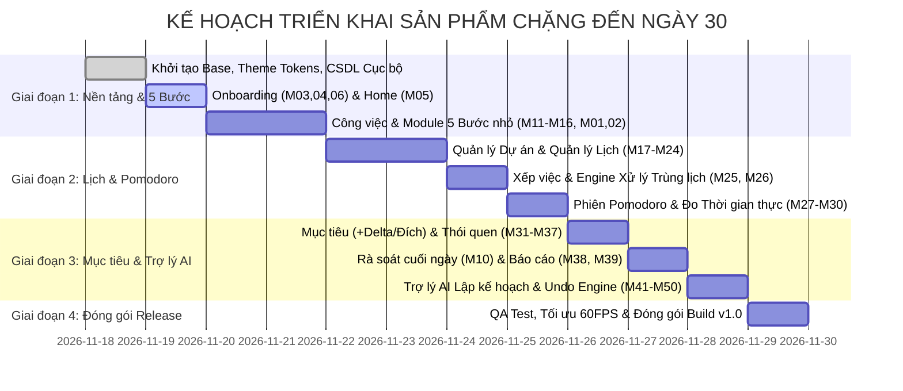

# DANH SÁCH TÍNH NĂNG TOÀN DIỆN & KẾ HOẠCH TRIỂN KHAI ĐẾN NGÀY 30
## ỨNG DỤNG HỌC TẬP & QUẢN LÝ TIẾN ĐỘ: CHẶNG (CHANG APP)

---

## PHẦN 1: BẢNG DANH SÁCH CHỨC NĂNG HỆ THỐNG (PRODUCT BACKLOG & FUNCTION SPECIFICATION)

Toàn bộ 50 màn hình (M01 - M50) được chuẩn hóa thành 32 tính năng kỹ thuật, phân cấp theo mức độ ưu tiên MoSCoW (Must-have, Should-have, Could-have) và ước lượng Story Points (SP - thang Fibonacci: 1, 2, 3, 5, 8, 13).

| Mã Feature | Tên Tính năng & Mô tả Kỹ thuật | Màn hình liên quan | Phân hệ (Module) | Độ ưu tiên (MoSCoW) | Story Points |
| :--- | :--- | :--- | :--- | :---: | :---: |
| **FEAT-01** | **Khởi tạo & Onboarding tương tác:** Intro hoạt họa linh vật 1.2s, chọn định hướng học tập, thiết lập khung giờ vàng và thời lượng cam kết hàng ngày. | M06, M03, M04 | Khởi động & Hồ sơ | **Must** | 5 |
| **FEAT-02** | **Bảng điều khiển Trung tâm (Home Dashboard):** Tích hợp widget Việc hôm nay, Lịch gần nhất, Tiến độ tuần và biểu tượng cảm xúc linh vật. | M05 | Khởi động & Hồ sơ | **Must** | 5 |
| **FEAT-03** | **Quản lý Hộp việc chưa lên lịch (Unscheduled Inbox):** Thu thập nhanh công việc, ý tưởng phát sinh không có ngày giờ cố định. | M01 | Công việc & 5 Bước | **Must** | 3 |
| **FEAT-04** | **Lên kế hoạch cho hôm nay (Daily Planning Queue):** Kéo việc từ Inbox hoặc việc tồn đọng vào hàng chờ thực hiện trong ngày. | M02 | Công việc & 5 Bước | **Must** | 3 |
| **FEAT-05** | **Tạo công việc & Phân rã 5 bước nhỏ:** Form tạo việc bắt buộc/khuyến khích chia tối đa 5 bước (micro-steps), gắn deadline và priority. | M12 | Công việc & 5 Bước | **Must** | 5 |
| **FEAT-06** | **Thực thi chi tiết & Theo dõi tiến độ việc:** Checkbox hoàn thành từng bước nhỏ, thanh tiến độ tỷ lệ %, nút kích hoạt phiên học cho bước cụ thể. | M13 | Công việc & 5 Bước | **Must** | 5 |
| **FEAT-07** | **Chỉnh sửa công việc (Draft vs Saved):** Cơ chế bảo toàn dữ liệu, cảnh báo thay đổi chưa lưu, hủy thay đổi hoặc cập nhật. | M14 | Công việc & 5 Bước | **Should** | 3 |
| **FEAT-08** | **Quản lý danh sách 5 bước nhỏ:** Thêm, xóa, đổi tên, đổi thứ tự bước qua menu 3 chấm (fallback thay thế thao tác kéo thả phức tạp). | M15 | Công việc & 5 Bước | **Must** | 3 |
| **FEAT-09** | **Danh sách công việc & Bộ lọc thông minh:** Tab phân loại (Hôm nay, Sắp tới, Quá hạn), tìm kiếm từ khóa, lọc theo Dự án và Độ ưu tiên. | M11, M16 | Công việc & 5 Bước | **Must** | 5 |
| **FEAT-10** | **Lưu trữ & Mở lại việc đã hoàn thành (Archive/Reopen):** Danh sách việc đã xong kèm ngày hoàn thành, nút khôi phục việc về trạng thái làm tiếp. | M20 | Công việc & 5 Bước | **Should** | 2 |
| **FEAT-11** | **Quản lý Dự án học tập:** Tạo dự án kèm màu nhận diện thương hiệu, mục tiêu, deadline và theo dõi tiến độ tổng thể các task con. | M17, M18, M19 | Quản lý Dự án | **Must** | 5 |
| **FEAT-12** | **Lịch tuần thu gọn trên Mobile (Weekly Strip):** Dải trượt 7 ngày kèm chấm chỉ báo mật độ học tập, chuyển đổi nhanh giữa các ngày. | M21 | Lịch biểu | **Must** | 5 |
| **FEAT-13** | **Lịch ngày chi tiết (Timeline & Free Slots):** Trục thời gian 24h thể hiện sự kiện đã có, vạch giờ hiện tại và nút xếp việc tại các khoảng trống. | M22 | Lịch biểu | **Must** | 5 |
| **FEAT-14** | **Tạo & Hiệu chỉnh Lịch hẹn cố định:** Đặt lịch học trên lớp, ca thi, hỗ trợ lặp lại hàng tuần và nhắc trước 15-30 phút. | M23, M24 | Lịch biểu | **Must** | 5 |
| **FEAT-15** | **Xếp việc vào khoảng trống lịch:** Chọn công việc và bước nhỏ cụ thể để lấp vào khoảng thời gian trống đã chọn, có preview trước. | M25 | Lịch biểu | **Must** | 5 |
| **FEAT-16** | **Bộ xử lý Xung đột Lịch (Conflict Resolution Engine):** Phát hiện đè giờ, gợi ý khung giờ trống kế tiếp hoặc tùy chọn ghi đè có kiểm soát. | M26 | Lịch biểu | **Must** | 8 |
| **FEAT-17** | **Chuẩn bị phiên tập trung (Focus Prep):** Chọn bước nhỏ cần làm, thời lượng (15-25-45p), chọn âm thanh nền (White noise). | M27 | Phiên Pomodoro | **Must** | 3 |
| **FEAT-18** | **Đồng hồ Tập trung & Linh vật tương tác:** Đếm ngược toàn màn hình, linh vật tĩnh chống xao nhãng, hỗ trợ thu gọn PiP/Mini bar. | M28 | Phiên Pomodoro | **Must** | 8 |
| **FEAT-19** | **Tạm dừng & Tiếp tục phiên học:** Bảo toàn chính xác số giây đã chạy, linh vật đổi tư thế nghỉ ngơi, tiếp tục hoặc kết thúc ngay. | M29 | Phiên Pomodoro | **Must** | 3 |
| **FEAT-20** | **Tổng kết phiên & Xác nhận tiến độ độc lập:** Ghi nhận thời gian thực tế (không làm tròn 25p), hỏi xác nhận hoàn thành bước nhỏ tách biệt. | M30 | Phiên Pomodoro | **Must** | 5 |
| **FEAT-21** | **Mục tiêu định lượng (Quantitative Goals):** Quản lý mục tiêu đo đếm bằng số (từ vựng, trang sách, giờ học, đề thi) và hạn chót. | M31, M32 | Mục tiêu & Milestone | **Must** | 5 |
| **FEAT-22** | **Ghi nhận thêm tiến độ số học (+Delta Log):** Thêm số lượng vừa học (+10 từ), cập nhật thanh phần trăm và lưu nhật ký tăng trưởng. | M33 | Mục tiêu & Milestone | **Must** | 5 |
| **FEAT-23** | **Điều chỉnh đích mục tiêu (Target Adjustment):** Đổi con số chỉ tiêu mà bảo toàn 100% lịch sử ghi nhận cũ, tính lại tỷ lệ phần trăm. | M34 | Mục tiêu & Milestone | **Must** | 3 |
| **FEAT-24** | **Ăn mừng Đạt mốc Mục tiêu (Milestone Celebration):** Popup vinh danh linh vật khi chạm đích 100%, cấp huy hiệu và gợi ý lập mục tiêu mới. | M40 | Mục tiêu & Milestone | **Should** | 3 |
| **FEAT-25** | **Theo dõi Thói quen hàng ngày & Điểm danh:** Check-in hoàn thành thói quen trong ngày, hỗ trợ hoàn tác (Undo) chống bấm nhầm. | M35, M36 | Thói quen rèn luyện | **Must** | 5 |
| **FEAT-26** | **Biểu đồ nhiệt Streak Thói quen:** Heatmap phân biệt rõ ngày hoàn thành, ngày nghỉ kế hoạch (không đứt chuỗi) và ngày chưa đến. | M37 | Thói quen rèn luyện | **Should** | 5 |
| **FEAT-27** | **Rà soát cuối ngày (End-of-day Rollover):** Quét việc chưa xong hôm nay: chọn chuyển sang mai hoặc trả về Inbox; bảo toàn hạn nộp gốc. | M10 | Rà soát & Thống kê | **Must** | 5 |
| **FEAT-28** | **Báo cáo Tiến độ & Nhìn lại tuần:** Thống kê tổng giờ học thực tế, số phiên hoàn thành, đồ thị tuần và khung giờ vàng tập trung. | M38, M39 | Rà soát & Thống kê | **Should** | 5 |
| **FEAT-29** | **Hội thoại Trợ lý AI & Khảo sát ràng buộc:** Nhận prompt tự nhiên, hỏi làm rõ thời gian rảnh và mức độ ưu tiên môn học. | M41, M42 | Trợ lý AI Co-pilot | **Must** | 5 |
| **FEAT-30** | **Kiểm duyệt Phạm vi Dữ liệu & Tạo bản nháp AI:** Minh bạch dữ liệu AI được đọc, thanh tiến trình xử lý và quyền hủy ngang. | M43, M44 | Trợ lý AI Co-pilot | **Must** | 5 |
| **FEAT-31** | **Xem trước, Giải thích & Chỉnh sửa đề xuất AI:** Xem trước các khối lịch xếp đề xuất, giải thích lý do logic, cho phép sửa trước khi chốt. | M45, M46, M47 | Trợ lý AI Co-pilot | **Must** | 8 |
| **FEAT-32** | **Áp dụng Kế hoạch AI & Chốt an toàn Hoàn tác (Undo):** Ghi batch vào lịch, nút Undo khôi phục 100% nguyên trạng, kiểm soát audit log. | M48, M49, M50 | Trợ lý AI Co-pilot | **Must** | 8 |

**Tổng Story Points:** 157 SP  
**Tỷ lệ phân bổ:** Must-have (85%), Should-have (15%).

---

## PHẦN 2: BẢNG KẾ HOẠCH TRIỂN KHAI CHI TIẾT TỪ HÔM NAY ĐẾN NGÀY 30

### ĐẶC TẢ NGĂN XẾP CÔNG NGHỆ (TECH STACK SPECIFICATION)
* **Mobile Frontend:** **Flutter (Dart 3.x)**
  * Quản lý State & Dependency Injection: `flutter_riverpod` hoặc `flutter_bloc`.
  * Điều hướng màn hình (Routing): `go_router` (Quản lý chặt chẽ 50 màn hình và Deep Link).
  * Đồng bộ & Bộ đệm cục bộ (Offline-First): `drift` (SQLite) hoặc `hive` kết hợp `supabase_flutter`.
  * Đếm giờ chạy ngầm & Thông báo: `flutter_foreground_task`, `flutter_local_notifications`.
  * Âm thanh tập trung (White noise): `just_audio`.
* **Backend & Cloud Services:** **Supabase Ecosystem**
  * Database: Managed **PostgreSQL 15+** với 15 bảng nghiệp vụ chuẩn 3NF.
  * Authentication: **Supabase Auth** (Email/Password & Social Auth), tự động đồng bộ `auth.users`.
  * Bảo mật đa người dùng: **Row Level Security (RLS)** phân quyền theo `auth.uid() = user_id`.
  * Realtime Sync: **Supabase Realtime** đẩy sự kiện tức thì về Flutter qua WebSockets.
  * Serverless Computing: **Supabase Edge Functions** (TypeScript / Deno) cho engine AI và tự động hóa.
  * File Storage: **Supabase Storage** (Bucket `avatars`, `project_assets`).

> **Giai đoạn Sprint:** Từ ngày **18/11/2026** đến ngày **30/11/2026** (13 ngày tập trung cao độ hoàn thiện sản phẩm MVP hoàn chỉnh, kiểm thử toàn diện và đóng gói ứng dụng di động).

---

### CHI TIẾT TỪNG NGÀY TỪ NGÀY 18 ĐẾN NGÀY 30

#### NGÀY 18 (HÔM NAY): THIẾT KẾ KIẾN TRÚC, DESIGN SYSTEM & DATABASE ENGINE
- **Mục tiêu ngày:** Hoàn thiện hồ sơ kỹ thuật, khởi tạo cấu trúc dự án Mobile và thiết lập hệ thống Design Tokens.
- **Frontend Mobile:**
  - Cấu trúc thư mục Clean Architecture: `core/`, `theme/`, `features/`, `data/`, `widgets/`.
  - Khai báo trọn vẹn bộ Token màu sắc (`brand/primary`, `brand/honey`, `brand/peach`, `background/page`), Typography (`Inter`) và Dimensions (`space/16`, `radius/12`, v.v.).
- **Backend / Local DB:**
  - Khởi tạo SQLite/Room schema 15 bảng theo chuẩn thiết kế ERD.
  - Viết các Migration scripts và Database Access Objects (DAOs) cơ sở.
- **Tiêu chí nghiệm thu (DoD):** Biên dịch thành công dự án khung, test kết nối CSDL cục bộ tạo đủ 15 bảng.

---

#### NGÀY 19: ONBOARDING, CÀI ĐẶT CÁ NHÂN & DASHBOARD HOME (M03, M04, M05, M06, M08, M09)
- **Mục tiêu ngày:** Người dùng có thể đi qua luồng giới thiệu lần đầu và tương tác trên màn hình chính.
- **Frontend Mobile:**
  - `M06 (Splash/Intro)`: Dựng animation linh vật 1.2s vẫy tay chào, 3 tiêu điểm giới thiệu, nút Bắt đầu / Bỏ qua.
  - `M03, M04`: Giao diện chọn định hướng học tập và thiết lập giờ vàng + thời lượng mục tiêu.
  - `M05 (Home Dashboard)`: Layout card tiến độ ngày, widget sự kiện lịch gần nhất, thanh tiến độ tuần.
  - `M08, M09`: Màn hình Profile và Cài đặt (Giờ yên tĩnh, Mascot toggle, Reduced motion).
- **Backend / Local DB:**
  - Logic lưu cờ `has_completed_onboarding` vào SharedPreferences / Local KV.
  - DAO truy vấn tổng hợp dữ liệu cho Home widget.
- **Tiêu chí nghiệm thu (DoD):** Mở app lần đầu hiện Intro -> Điền onboarding -> Vào Home. Lần sau mở app đi thẳng vào Home.

---

#### NGÀY 20: QUẢN LÝ CÔNG VIỆC CỐT LÕI & CHIA NHỎ 5 BƯỚC (M01, M02, M11, M12)
- **Mục tiêu ngày:** Người dùng có thể thu thập việc vào Inbox và tạo công việc chia nhỏ tối đa 5 bước.
- **Frontend Mobile:**
  - `M01 (Inbox)`: Danh sách việc chưa lên lịch, quick add text input.
  - `M02 (Lên kế hoạch hôm nay)`: Chọn việc từ Inbox cam kết cho hôm nay.
  - `M11 (Danh sách việc)`: Tab Hôm nay / Sắp tới / Quá hạn.
  - `M12 (Tạo công việc)`: Form nhập tên, chọn hạn nộp, ưu tiên và cụm **Chia nhỏ tối đa 5 bước** (Khóa nút khi đã đủ 5 bước).
- **Backend / Local DB:**
  - DAO xử lý transaction: Insert `Task` đồng thời Insert 1..5 `Subtask`.
  - Validate ràng buộc `order_index` từ 1 đến 5.
- **Tiêu chí nghiệm thu (DoD):** Tạo việc thành công với 3 đến 5 bước nhỏ; kiểm tra không thể thêm bước thứ 6; việc không có ngày tự động vào Inbox.

---

#### NGÀY 21: CHI TIẾT CÔNG VIỆC, QUẢN LÝ BƯỚC NHỎ & BỘ LỌC TÌM KIẾM (M13, M14, M15, M16, M20)
- **Mục tiêu ngày:** Tương tác mượt mà với từng bước nhỏ, cập nhật tiến độ và lọc tìm kiếm.
- **Frontend Mobile:**
  - `M13 (Chi tiết công việc)`: Checkbox tick từng bước, tính % tiến độ, nút "Tập trung vào bước này".
  - `M14 (Chỉnh sửa)`: Phân biệt dữ liệu đã lưu vs đang sửa, hủy thay đổi.
  - `M15 (Quản lý 5 bước)`: Menu 3 chấm (Chuyển lên, Chuyển xuống, Đổi tên, Xóa).
  - `M16 (Tìm kiếm/Lọc)` & `M20 (Việc đã hoàn thành & Nút mở lại)`.
- **Backend / Local DB:**
  - Cập nhật `Subtask.is_completed`, tự động kích hoạt trigger tính lại `Task.progress_percentage`.
  - Truy vấn tìm kiếm full-text search theo từ khóa và filter dự án.
- **Tiêu chí nghiệm thu (DoD):** Tick bước 1 -> tiến độ nhảy lên 20% (nếu 5 bước). Đổi thứ tự bước qua menu mượt mà, không phụ thuộc thao tác kéo thả.

---

#### NGÀY 22: QUẢN LÝ DỰ ÁN & LỊCH BIỂU TIMELINE CƠ BẢN (M17, M18, M19, M21, M22)
- **Mục tiêu ngày:** Tổ chức công việc theo Dự án học tập và xem lịch theo dải tuần/ngày.
- **Frontend Mobile:**
  - `M17, M18, M19`: Danh sách dự án, tạo dự án với bảng chọn 6 màu token, màn hình chi tiết dự án kèm danh sách việc con.
  - `M21 (Lịch tuần)`: Dải chọn ngày (Date strip) có chấm chỉ báo bận rộn.
  - `M22 (Lịch ngày)`: Trục 24h timeline, hiển thị các khối lịch, vạch giờ hiện tại và khoảng trống.
- **Backend / Local DB:**
  - Bảng `Project` DAO, logic liên kết `Task.project_id`.
  - Thuật toán quét và nhận diện các **Khoảng trống khả dụng (Free Slots)** giữa các sự kiện.
- **Tiêu chí nghiệm thu (DoD):** Bấm "Thêm việc" trong dự án tự động gắn `project_id`. Bấm từng ngày trên Lịch tuần cập nhật đúng timeline ngày.

---

#### NGÀY 23: TẠO LỊCH HẸN & BẢNG SO SÁNH GIỜ CHƯA LƯU (M23, M24)
- **Mục tiêu ngày:** Quản lý các lịch học cố định, ca thi, hỗ trợ nhắc nhở trước.
- **Frontend Mobile:**
  - `M23 (Tạo lịch hẹn)`: Chọn loại lịch (Học trên lớp, Tự học, Thi cử), picker giờ bắt đầu/kết thúc, chọn chu kỳ lặp và nhắc nhở.
  - `M24 (Sửa lịch)`: So sánh giờ hiện tại vs giờ dự kiến thay đổi, nút Lưu / Hủy.
- **Backend / Local DB:**
  - Bảng `ScheduleEvent` DAO. Tích hợp Local Notification Scheduler lên lịch thông báo trước 15 phút.
- **Tiêu chí nghiệm thu (DoD):** Tạo lịch hẹn thành công, hiển thị đúng vị trí trên timeline `M22`, nhận thông báo nhắc trước chuẩn giờ.

---

#### NGÀY 24: XẾP VIỆC VÀO LỊCH & BỘ XỬ LÝ TRÙNG LỊCH THÔNG MINH (M25, M26)
- **Mục tiêu ngày:** Gán công việc vào khoảng trống; xử lý triệt để xung đột thời gian.
- **Frontend Mobile:**
  - `M25 (Xếp việc vào lịch)`: Chọn việc, chọn bước nhỏ, preview khung giờ trên timeline.
  - `M26 (Xử lý trùng lịch)`: Modal hiển thị xung đột kèm 3 lựa chọn (Chấp nhận giờ gợi ý, Tự chọn giờ khác, Vẫn thêm vào giờ trùng).
- **Backend / Local DB:**
  - **Conflict Detection Algorithm:** So khớp `(start_time_new < end_time_old) AND (end_time_new > start_time_old)`.
  - **Slot Finder:** Tự động tìm khoảng trống tiếp theo đủ `duration_minutes` để gợi ý cho người dùng.
- **Tiêu chí nghiệm thu (DoD):** Xếp việc vào giờ bị trùng lịch lập tức mở `M26`; chọn giờ đề xuất quay về preview với giờ mới; chỉ ghi vào CSDL khi bấm "Thêm vào lịch".

---

#### NGÀY 25: PHIÊN TẬP TRUNG POMODORO CẢI TIẾN & TÍNH THỜI GIAN THỰC (M27, M28, M29, M30)
- **Mục tiêu ngày:** Trải nghiệm học sâu không xao nhãng, tính toán thời gian thực tế chính xác đến từng giây.
- **Frontend Mobile:**
  - `M27`: Chọn bước nhỏ, thời lượng, white noise player.
  - `M28`: Đồng hồ đếm ngược tròn, linh vật ở tư thế tập trung tĩnh (không lặp animation), nút Tạm dừng, Kết thúc sớm, Thu gọn.
  - `M29`: Màn hình tạm dừng, giữ nguyên đồng hồ, tiếp tục học.
  - `M30`: Màn hình tổng kết phiên với màu nền `brand/honey-soft`, hiển thị số phút giây thực tế, câu hỏi xác nhận riêng rẽ tiến độ bước nhỏ.
- **Backend / Local DB:**
  - Android/iOS Foreground Service giữ timer chạy nền ổn định khi tắt màn hình hoặc thu gọn app.
  - Ghi nhận `actual_duration_seconds` chính xác; cập nhật bước nhỏ nếu người dùng xác nhận hoàn thành.
- **Tiêu chí nghiệm thu (DoD):** Dừng phiên ở phút 14:10 -> màn hình tổng kết ghi đúng 14 phút 10 giây (không ghi 25p). Hoàn thành bước 3 chỉ tăng tiến độ từ 2/5 lên 3/5, không tự ý hoàn thành cả task lớn.

---

#### NGÀY 26: MỤC TIÊU ĐỊNH LƯỢNG & RÈN LUYỆN THÓI QUEN (M31 - M37, M40)
- **Mục tiêu ngày:** Theo dõi chỉ số mục tiêu số học và chuỗi streak thói quen.
- **Frontend Mobile:**
  - `M31, M32`: Danh sách mục tiêu định lượng và form tạo mục tiêu.
  - `M33`: Màn hình chi tiết, lịch sử ghi nhận, nút **"Ghi nhận thêm" (+10 từ)**.
  - `M34`: Màn hình **"Điều chỉnh mục tiêu" (đổi đích từ 100 thành 80)** có ghi chú minh bạch.
  - `M40`: Màn hình Chúc mừng đạt mốc (Milestone Celebration) khi chạm đích.
  - `M35, M36, M37`: Danh sách thói quen hôm nay (kèm Undo), tạo thói quen và Heatmap streak tháng (phân biệt ngày nghỉ kế hoạch).
- **Backend / Local DB:**
  - Phân tách logic: `GoalProgressLog` (+delta) vs `Goal.target_value` (đổi đích).
  - Thuật toán tính Streak: bỏ qua các `REST_DAY` mà không làm đứt chuỗi.
- **Tiêu chí nghiệm thu (DoD):** Đang 40/100, nhập thêm 10 -> thành 50/100; đổi đích thành 80 -> thành 40/80 (không tạo log mới). Check-in thói quen hôm nay có thể hoàn tác ngay.

---

#### NGÀY 27: RÀ SOÁT CUỐI NGÀY & BÁO CÁO THỐNG KÊ (M10, M38, M39, M07)
- **Mục tiêu ngày:** Làm sạch danh sách việc trước khi đi ngủ và tổng kết tuần.
- **Frontend Mobile:**
  - `M10 (Rà soát cuối ngày)`: Liệt kê việc chưa xong hôm nay: [Chuyển sang mai] hoặc [Trả về Inbox].
  - `M38, M39`: Màn hình phân tích tổng số phút học thực tế, số phiên, đồ thị năng suất tuần.
  - `M07`: Trung tâm thông báo điều hướng chính xác.
- **Backend / Local DB:**
  - Rollover Logic: Cập nhật `scheduled_date = Tomorrow` hoặc `scheduled_date = NULL` (bảo toàn 100% `due_date` gốc).
  - Aggregate queries nhóm theo tuần/tháng từ `FocusSession`.
- **Tiêu chí nghiệm thu (DoD):** Rà soát dọn dẹp việc hôm nay làm sạch widget Home; số việc hoàn thành trên báo cáo chỉ tăng khi người dùng hoàn thành công việc, không tăng theo số phiên.

---

#### NGÀY 28: TRỢ LÝ AI LẬP KẾ HOẠCH - KHẢO SÁT & KIỂM DUYỆT (M41, M42, M43, M44)
- **Mục tiêu ngày:** Khởi tạo yêu cầu với AI, hội thoại làm rõ ràng buộc và kiểm soát quyền dữ liệu.
- **Frontend Mobile:**
  - `M41`: Template gợi ý câu lệnh và ô prompt tự do.
  - `M42`: Hội thoại dạng tin nhắn làm rõ thời gian rảnh và việc ưu tiên.
  - `M43`: Bảng tóm tắt thông số và hộp thông tin **Phạm vi dữ liệu AI được truy cập**.
  - `M44`: Màn hình xử lý tạo bản nháp có thanh tiến trình và nút Hủy.
- **Backend / AI Engine:**
  - Tích hợp Gemini API / Mock AI Service xử lý phân tích prompt và trích xuất tham số (`time_constraints`, `priority_tasks`).
- **Tiêu chí nghiệm thu (DoD):** Người dùng nhập yêu cầu -> AI hỏi lại rõ ràng -> Người dùng duyệt phạm vi dữ liệu trước khi thuật toán chạy; nút Hủy tại M44 hoạt động an toàn.

---

#### NGÀY 29: XEM TRƯỚC, GIẢI THÍCH, ÁP DỤNG & HOÀN TÁC KẾ HOẠCH AI (M45 - M50)
- **Mục tiêu ngày:** Hoàn thiện luồng AI Co-pilot: giải thích căn cứ, cho phép chỉnh sửa và nút Undo an toàn tuyệt đối.
- **Frontend Mobile:**
  - `M45`: Xem trước các khối lịch dự kiến xếp vào ngày/tuần.
  - `M46`: Bottom sheet giải thích căn cứ logic tại sao xếp môn đó vào giờ đó.
  - `M47`: Chỉnh sửa thời lượng, đổi thứ tự trước khi duyệt.
  - `M48`: Màn hình Áp dụng thành công kèm nút nổi bật **"Hoàn tác áp dụng" (Undo)**.
  - `M49`: Màn hình xử lý khi lịch bị kín (giữ nguyên prompt).
  - `M50`: Trang kiểm soát lịch sử AI và quản lý quyền riêng tư.
- **Backend / Local DB:**
  - Batch Insert `ScheduleEvent` kèm `ai_proposal_id`.
  - **Undo Engine:** Thực thi lệnh Rollback xóa sạch toàn bộ các sự kiện thuộc `ai_proposal_id` khi người dùng bấm Hoàn tác.
- **Tiêu chí nghiệm thu (DoD):** Áp dụng kế hoạch AI thêm 4 buổi học vào lịch -> Bấm nút Hoàn tác tại M48 -> 4 buổi học biến mất hoàn toàn, lịch trở về nguyên trạng ban đầu 100%.

---

#### NGÀY 30: KIỂM THỬ TOÀN DIỆN, TỐI ƯU HIỆU NĂNG 60FPS & ĐÓNG GÓI BẢN RELEASE BUILD
- **Mục tiêu ngày:** Đảm bảo toàn bộ 50 màn hình hoạt động trơn tru không lỗi, tối ưu bộ nhớ và xuất file cài đặt APK / IPA.
- **Các hạng mục thực hiện:**
  1. **Kiểm thử E2E (End-to-End Testing):**
     - Luồng 1: Onboarding -> Tạo việc 5 bước -> Bấm giờ tập trung 15p -> Tổng kết tiến độ thực -> Hoàn thành bước 1.
     - Luồng 2: Xếp việc vào lịch -> Xử lý trùng giờ -> Chấp nhận giờ gợi ý.
     - Luồng 3: Tạo mục tiêu 100 từ -> Ghi nhận thêm 10 từ -> Điều chỉnh đích 80 từ -> Chúc mừng đạt mốc.
     - Luồng 4: Yêu cầu AI xếp lịch -> Xem trước -> Áp dụng -> Thử nghiệm Hoàn tác (Undo).
     - Luồng 5: Rà soát cuối ngày dọn dẹp việc chưa làm.
  2. **Tối ưu hóa Giao diện & Hiệu năng (UI/UX Performance):**
     - Đảm bảo animation linh vật chỉ chạy khi đổi trạng thái; màn hình Pomodoro tĩnh 100%.
     - Kiểm tra các touch target đạt chuẩn tối thiểu 48x48px.
     - Đo lường FPS duy trì ổn định 60–120 FPS khi cuộn danh sách.
  3. **Đóng gói Bản phát hành (Release Package):**
     - Đóng gói file cài đặt Mobile App (Android APK / AAB & iOS Archive).
     - Xuất bản báo cáo kiểm thử và tài liệu bàn giao sản phẩm.
- **Tiêu chí nghiệm thu (DoD):** 0 lỗi Crash (Crash-free rate 100%), hoàn thành trọn vẹn 32/32 tính năng kỹ thuật và sẵn sàng đưa vào sử dụng thực tế.

---

## PHẦN 3: MA TRẬN QUẢN TRỊ RỦI RO & PHƯƠNG ÁN GIẢM THIỂU (RISK MATRIX)

| Mã Rủi ro | Nguy cơ tiềm ẩn | Mức độ | Khả năng | Phương án phòng ngừa & Giảm thiểu |
| :--- | :--- | :---: | :---: | :--- |
| **RISK-01** | Timer đếm giờ Pomodoro bị hệ điều hành tắt ngầm khi khóa màn hình. | Cao | Trung bình | Sử dụng Foreground Service kèm Persistent Notification trên Android và Live Activities / Audio session trên iOS để giữ tiến trình sống. |
| **RISK-02** | Xung đột lịch phức tạp khi xếp nhiều sự kiện chồng chéo. | Trung bình | Thấp | Xây dựng thuật toán quét khe hở thời gian (Interval Slot Search) và luôn có bước trung gian `M26` hỏi ý kiến người dùng trước khi ghi đè. |
| **RISK-03** | Người dùng hoang mang khi AI tự ý thay đổi lịch học. | Cao | Thấp | Nguyên tắc thiết kế **Human-in-the-loop**: Bắt buộc qua màn hình Xem trước `M45`, nút Hoàn tác `M48` và màn hình Audit log `M50`. |
| **RISK-04** | Dữ liệu tiến độ bị sai lệch khi người dùng chỉnh sửa mục tiêu. | Trung bình | Thấp | Tách độc lập 2 luồng toán học: Ghi nhận thêm (`+delta` vào `GoalProgressLog`) và Điều chỉnh đích (`target_value` trong `Goal`), hiển thị cảnh báo minh bạch. |

---

## PHẦN 4: ĐỊNH NGHĨA HOÀN THÀNH (DEFINITION OF DONE - DOD)

Một tính năng được coi là hoàn thành khi thỏa mãn đầy đủ 5 tiêu chí:
1. **Thiết kế:** Tuân thủ 100% bộ Design Tokens (Màu sắc, Typography Inter, Kích thước, Icon Lucide).
2. **Nghiệp vụ:** Đáp ứng đúng các quy tắc độc lập thời gian thực tế, chia nhỏ tối đa 5 bước, và xử lý trùng lịch.
3. **Mã nguồn:** Clean code, phân tầng rõ ràng, xử lý đầy đủ các trạng thái Loading, Empty State, Error State.
4. **Kiểm thử:** Đạt bài test chức năng theo Use Case tương ứng, không gây rò rỉ bộ nhớ (memory leak).
5. **Người dùng:** Trải nghiệm mượt mà, phản hồi cảm ứng tức thì (dưới 100ms) trên thiết bị di động thật.

---
*Kế hoạch hành động chuẩn Agile/Scrum cam kết bàn giao sản phẩm Chặng App hoàn thiện đúng tiến độ ngày 30.*
